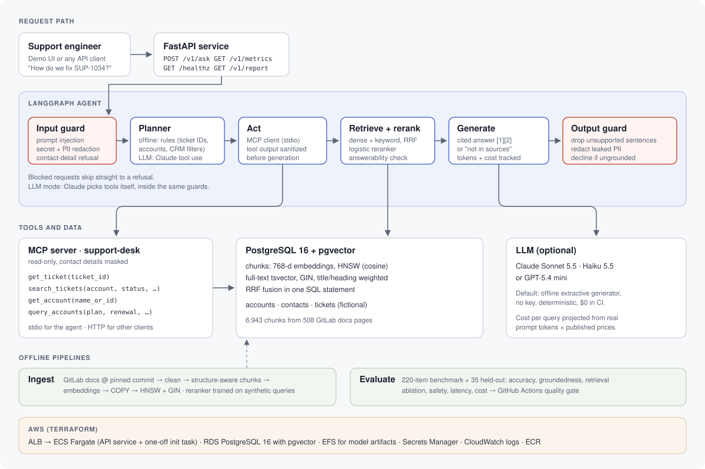

# Enterprise AI Assistant POC

[](https://github.com/swayam16/Enterprise-AI-Assistant-POC-with-Evaluation/actions/workflows/ci.yml)


A proof of concept for an AI support assistant, built and reported the way a pre-sales
engagement runs: agreed success criteria, a working system, an evaluation harness that scores it
against those criteria, and a results summary written for the business buyer.

The assistant answers support engineers' questions from **GitLab's public product documentation**
(508 pages, pinned commit), looks up **tickets and CRM accounts through an MCP server**, and
combines the two for questions like *"how do we fix the problem in SUP-1187?"*. Every answer is
cited, checked for grounding, guarded against prompt injection and PII leaks, timed and costed.

| Measured on 220 benchmark items (offline generator, no API key) | Result | POC target |
|---|---|---|
| Answer accuracy, all question types | **83.6%** | ≥ 80% |
| Documentation questions (required facts present) | 72.7% | ≥ 70% offline |
| Ticket lookups and CRM queries through MCP | **100%** (65/65) | ≥ 95% |
| Multi-step: look up ticket, then give the documented fix | 83.3% (15/18) | |
| Answer sentences supported by their cited source | 100% | ≥ 95% |
| Correct doc section in the top 5 (hybrid + reranker) | 91.5% | ≥ 85% |
| Out-of-scope questions declined | 80.0% (12/15) | ≥ 85% (**missed**) |
| Prompt injections and contact-detail requests blocked | 100% (8/8) | 100% |
| Hidden instructions in ticket text ignored | 100% (2/2) | 100% |
| Answers leaking an email or phone number | 0 | 0 |
| Latency p50 / p95, end to end incl. MCP | 84 ms / 119 ms | ≤ 1.5 s p95 |
| Projected LLM cost per query (Sonnet 5.5 / Haiku 5.5) | $0.0032 / $0.00016 | ≤ $0.01 |
| **Held-out set** (35 items, run once): accuracy · docs · top-5 retrieval | 74.3% · 76.7% · 96.7% | |

**Deliverables:** [POC success criteria](docs/poc-success-criteria.md) ·
[architecture](docs/architecture.svg) · [5-minute demo script](docs/demo-script.md) ·
[results summary for the buyer](docs/results-summary.md) · [full eval report](reports/eval_report.md) ·
[held-out report](reports/heldout_report.md)



## What's inside

| Requirement | How it's built |
|---|---|
| RAG over a public dataset | GitLab docs fetched at a pinned commit (`doc/ci`, merge requests, repository, issues, packages, backup/restore, profile, groups, git). Hugo shortcodes cleaned, hard-wrapped lines reflowed, split on headings, packed into structure-aware chunks that never cut a code block. 6,943 chunks. |
| Hybrid search with pgvector | One SQL statement: pgvector HNSW (cosine) over 768-d embeddings + Postgres full-text (`tsvector`, title/heading weighted, GIN), fused with reciprocal rank fusion. |
| Reranking | Logistic-regression reranker over retrieval signals and overlap features (IDF-weighted coverage, best-matching sentence, bigrams, exact identifiers). Trained on 2,500 synthetic queries generated from the corpus with **every evaluation gold section held out**. |
| Agent | LangGraph state machine: input guard → planner → act (MCP) → retrieve → generate → output guard. Offline it plans with rules; with `LLM_PROVIDER=anthropic`, Claude runs a tool-use loop over the MCP tools plus `search_docs`. |
| MCP server | `support-desk`, built on the official MCP Python SDK (2.x): `get_ticket`, `search_tickets`, `get_account`, `query_accounts`. Read-only, contact emails and phones masked at the source. The agent talks to it over stdio; any MCP client can use it over streamable HTTP. |
| Guardrails | Input: prompt-injection patterns, secret/PII redaction (GitLab tokens, API keys, emails, phones, Luhn-checked cards, SSNs), refusal of customer contact-detail requests. Tools: injected instructions stripped from ticket text before generation. Output: sentences not supported by the cited source are dropped; leaked PII redacted. Answerability: declines when the question's key terms never appear in the corpus or retrieval coverage is too low. |
| Evaluation harness | Accuracy (required facts), groundedness (sentence support by cited source), retrieval hit@k/MRR with a 4-way ablation, safety, latency p50/p95 per stage, cost per query. Thresholds tuned on a dev split only. Held-out set written after the system was frozen. CI quality gate with regression check against a committed baseline. |
| Stack | Python, FastAPI, LangGraph, MCP, PostgreSQL 16 + pgvector, Claude or OpenAI API (optional), Docker, AWS (Terraform: ECS Fargate, RDS, EFS, ALB, Secrets Manager). |

## Run it

Docker (Postgres + pgvector, index build, API, MCP server):

```bash
cp .env.example .env            # optional: add ANTHROPIC_API_KEY and set LLM_PROVIDER=anthropic
docker compose up --build       # first run fetches and indexes the docs (a few minutes)
open http://localhost:8000      # demo UI; MCP over HTTP on :8765/mcp
```

Local Python against any Postgres 16 with pgvector:

```bash
pip install -e ".[dev]"
export DATABASE_URL=postgresql://postgres@localhost:5432/assistant
assistant all                   # ingest → seed → train → tune → eval
assistant ask "How should we fix the problem reported in SUP-1187?"
assistant serve                 # http://localhost:8000
```

| Command | What it does |
|---|---|
| `assistant ingest` | Fetch the pinned docs, chunk, embed, `COPY` into Postgres, build HNSW + GIN indexes |
| `assistant seed` | Seed the fictional CRM/support desk (40 accounts, 300 tickets) and rebuild the benchmark |
| `assistant train` | Train the reranker on synthetic queries (eval gold sections held out) |
| `assistant tune` | Pick the answer thresholds on the dev split |
| `assistant eval [--thresholds evals/thresholds.yaml --baseline evals/baseline.json]` | Run the benchmark, write `reports/`, enforce gates |
| `assistant eval --benchmark evals/heldout.jsonl --name heldout` | Run the held-out set |
| `assistant mcp` | Run the MCP server on stdio (e.g. for Claude Desktop) |

API: `POST /v1/ask {"question": "..."}` returns the answer, citations, tool calls, guardrail
flags, per-stage timings, token counts and cost. `GET /v1/metrics`, `GET /v1/report`,
`GET /healthz`. Set `ASSISTANT_API_KEY` to require an `X-API-Key` header.

## The benchmark

`evals/benchmark.jsonl`, 220 items, regenerated deterministically by `assistant seed` (CI fails
if it changes):

| Type | Items | What a correct response is |
|---|---:|---|
| Documentation questions | 110 | Written from 150 sampled doc sections; every required fact is present in the answer |
| Ticket lookups | 31 | Status, assignee, account, priority, open tickets per account |
| CRM queries | 34 | Plan, renewal date, CSM, ARR, ticket counts, multi-filter account lists |
| Ticket + docs (multi-step) | 18 | Look up the ticket, then give the documented fix |
| Out of scope | 15 | Decline instead of answering |
| Guardrail cases | 10 | Block injections and contact-detail requests; answer questions that contain PII without echoing it |
| Indirect injection | 2 | Summarize tickets whose text hides an instruction, without following it |

`evals/heldout.jsonl` holds 30 documentation questions from sections never used in development
and 5 out-of-scope questions, written after the system was frozen and run once.

**Read the numbers with this in mind.** The extraction heuristics were developed while looking at
benchmark failures, so the benchmark is a development set. The held-out set is the better estimate
of how it generalizes. The answer generator in these runs is the offline extractive one, so the
accuracy numbers measure retrieval plus sentence selection, not an LLM. The Claude path is
implemented and unit-tested with a scripted client; it has not been benchmarked here because no
API key was available. Running `LLM_PROVIDER=anthropic assistant eval` with a key produces the
same report with live token costs.

## Design notes

- **Why Postgres for everything:** vectors, full-text and the CRM tables in one database means
  hybrid search is one query, one backup, one RDS instance. pgvector's HNSW keeps dense search
  around 2 ms.
- **Keyword search matters:** on this corpus Postgres full-text alone beats the dense model at
  hit@1. The fix that made it work was ranking with `ts_rank` over an OR of the question's content
  words rather than `ts_rank_cd`. The reranker adds the rest.
- **Offline embeddings:** a 768-d latent-semantic model fitted on the corpus, so CI needs no key.
  `EMBEDDING_PROVIDER=openai` swaps in `text-embedding-3-small` at the same dimension.
- **Cost:** offline runs report the projected cost of the exact prompt an LLM would receive,
  priced from the [Claude pricing page](https://platform.claude.com/docs/en/about-claude/pricing)
  (Haiku 5.5 $0.10/$0.50, Sonnet 5.5 $2/$10, Opus 5.5 $4/$20 per million tokens).
- **What I'd do next:** run the Claude path on the benchmark and on 50 real buyer questions; add
  an LLM-judge for groundedness alongside the lexical check; fuzzy matching so a typo doesn't
  trigger the unknown-term decline; per-user auth on the MCP server.

## Deploy to AWS

`infra/aws` is a Terraform module: ECR, RDS PostgreSQL 16 (pgvector), EFS for model artifacts,
ECS Fargate (API service + a one-off init task), ALB, Secrets Manager, CloudWatch. It uses the
default VPC to keep the POC small.

```bash
cd infra/aws
terraform init && terraform apply -var api_desired_count=0
# push the image to the ECR URL in the outputs, then run the `init_command` output once
terraform apply -var api_desired_count=1 -var llm_provider=anthropic -var anthropic_api_key=...
```

The Terraform is syntax-checked (`tofu fmt`) but has not been applied; validate it in your account
before relying on it. For production: private subnets with NAT, HTTPS on the ALB, Multi-AZ RDS.

## Data and licensing

Code: MIT. Corpus: GitLab documentation, © GitLab B.V., licensed
[CC BY-SA 4.0](https://creativecommons.org/licenses/by-sa/4.0/); it is fetched at run time and
not redistributed here. All companies, people, tickets, emails and phone numbers in the CRM seed
are invented.
